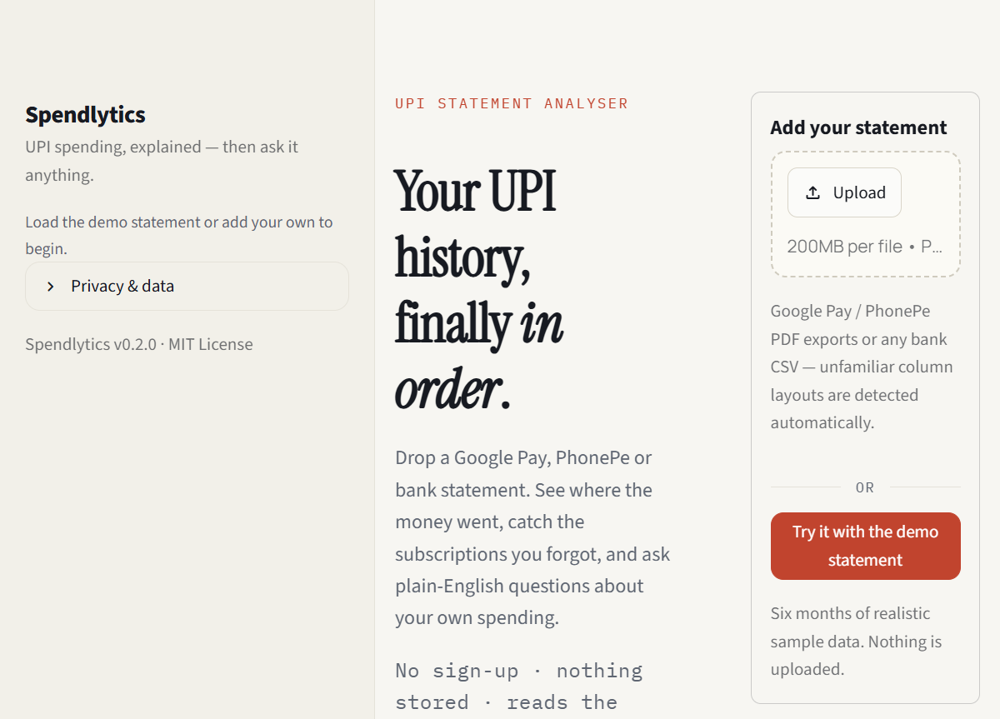
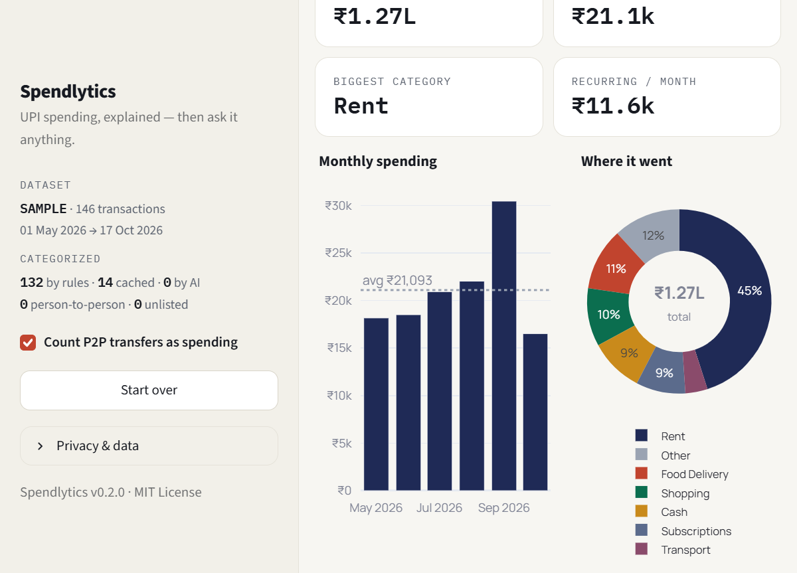
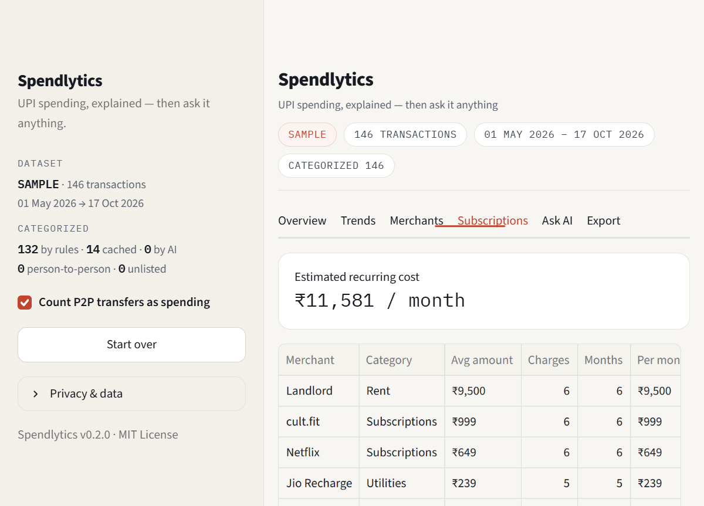
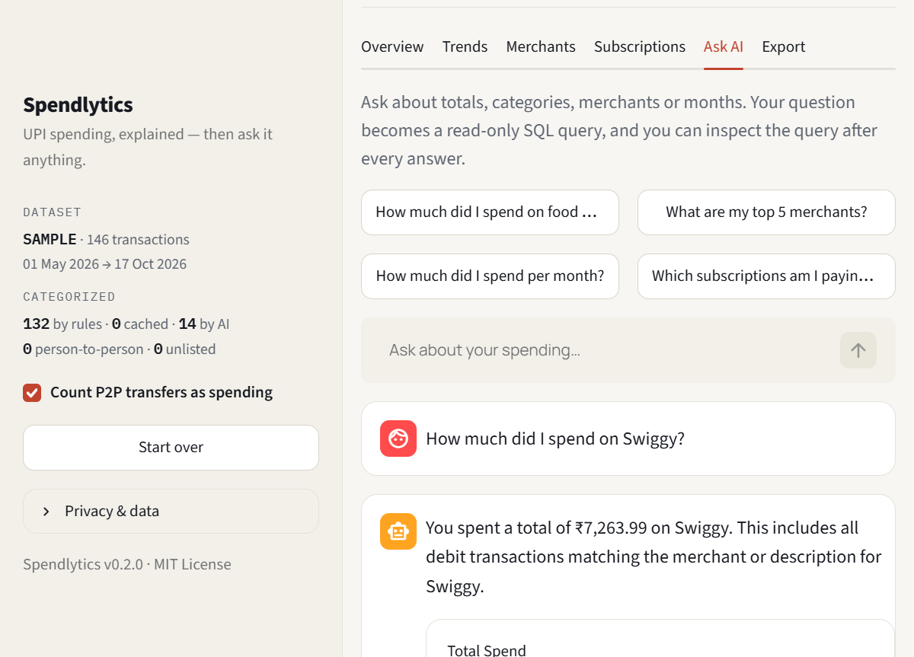
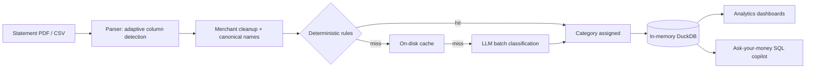

# 💸 Spendlytics

**Where did your money go?** Upload a UPI statement — get a clean spending dashboard, spot the subscriptions you forgot about, and ask plain-English questions about your own money.


## Screenshots









<sub>Captured from the built-in sample dataset (`python -m src.sample_data`).</sub>

---

## What it does

- **Parses real statements** — Google Pay / PhonePe PDF exports and bank CSVs, with adaptive column detection for formats it hasn't seen before.
- **Auto-categorizes every transaction** — rules → cache → LLM hybrid across 16 spending categories, with the rule-hit / cache-hit / AI-hit split shown honestly.
- **Finds the hidden money** — recurring subscriptions detected from *cadence + amount stability* (no hardcoded service list), the months that were way above average, and your food-delivery share.
- **Ask your money anything** — an NL→SQL copilot with real guardrails (read-only, single statement, LIMIT enforced) that answers with a number and a chart, and shows you the SQL it ran.
- **Privacy by design** — statements are processed in memory and never stored. If an AI key is configured, only cleaned merchant names are sent for categorisation — never amounts, dates or account numbers.

## How it works



**Parsing.** `pdfplumber` / CSV readers extract raw rows; a two-pass detector finds the date, description and amount columns by *header keywords first, content heuristics second*. UPI narrations like `UPI/DR/412345/RAZ*SWIGGY/YESB/swiggy@ybl` are cleaned to `Swiggy`.

**Categorisation.** 14 ordered rule groups cover national brands *and* generic neighbourhood language — pharmacy, medical, restaurant, dhaba, supermarket, kirana, fuel point, tuition centre, furniture — so informal merchants still land in the right bucket. Anything unresolved goes to a local JSON cache (so a merchant is never classified twice), then — only if an API key is present — to an LLM in batches of 40: answers are validated against the fixed category list, normalised (case, punctuation, code fences), and cached. No key? The app still works; unmatched rows fall back to P2P markers, then a person-name heuristic, then "Other".

**The copilot.** The LLM receives a fixed schema, few-shot examples, and a strict system prompt. Its SQL is then *validated in code*: single statement, `SELECT`/`WITH` only, forbidden-keyword scan, and a `LIMIT` added when missing. Only then does it run — against an in-memory DuckDB table that exists for one request. If the first attempt fails, the model gets one retry with the error message attached.

## Quickstart

```bash
git clone <your-repo-url>
cd spendlytics
py -m venv .venv
.venv\Scripts\Activate.ps1        # Windows PowerShell
# source .venv/bin/activate       # macOS / Linux
pip install -r requirements.txt
streamlit run app.py
```

No statement handy? Click **"Try it with the demo statement"** — the app loads six months of realistic synthetic transactions (generated deterministically by `src/sample_data.py`) so the whole experience works out of the box.

## Optional: enable the AI features (free)

The app runs fine without any key — rules + cache still categorise most merchants. To switch on LLM classification and the copilot:

1. Get a free key at [aistudio.google.com/apikey](https://aistudio.google.com/apikey) (no credit card).
2. Copy `.streamlit/secrets.toml.example` to `.streamlit/secrets.toml` and paste your key.
3. Run `python scripts/check_llm.py` — it verifies the key and lists the free models your account can use. If the default model name isn't available, set `GEMINI_MODEL` to one from that list.

A [Groq](https://console.groq.com/keys) key works as an alternative (`GROQ_API_KEY`).

## Tests

```bash
pip install -r requirements-dev.txt
pytest -q
```

55 tests cover amount/date parsing, merchant cleaning, column detection, the categoriser (rules, cache, LLM fallback, person-name heuristic), subscription detection, anomaly detection, chart builders, the SQL guardrails, and an end-to-end app smoke test (boot + demo flow) via Streamlit's `AppTest`. The suite runs offline by design (`SPENDLYTICS_DISABLE_LLM=1`), so it never spends API quota.

## Project structure

```
spendlytics/
├── app.py                     # Streamlit UI
├── src/
│   ├── models.py              # canonical transaction schema
│   ├── parsers/               # CSV + PDF -> transactions (adaptive detection)
│   ├── categorizer.py         # rules -> cache -> LLM pipeline
│   ├── analytics.py           # pure pandas analytics
│   ├── copilot.py             # NL->SQL with guardrails
│   ├── charts.py              # Plotly figures
│   ├── llm.py                 # Gemini / Groq client (graceful degradation)
│   └── sample_data.py         # deterministic demo dataset
├── scripts/
│   ├── inspect_statement.py   # debug an unfamiliar file format
│   ├── check_llm.py           # verify the AI setup
│   └── check_categorization.py # classify deliberately obscure merchants
└── tests/                     # pytest suite
```

## A format that doesn't parse?

Run `python scripts/inspect_statement.py <file>` — it prints the raw rows and exactly which columns the detector picked, which is everything needed to extend the parser in minutes. The architecture is deliberately format-agnostic, so new statement types are usually just a column-detection tweak.

## How this was built (AI-assisted workflow)

This project is AI-assisted, end to end — and that's part of the point. The split:

- **My decisions:** the category taxonomy, the subscription-detection heuristics (cadence window + amount stability thresholds), the SQL guardrail rules, the privacy model (in-memory processing, merchant-only LLM calls), the rule ordering that stops "Swiggy Instamart" from being labelled food delivery, and the demo narrative (the planted September spike proves the anomaly detector works).
- **AI's contribution:** first-draft implementations of the parsers, charts, UI boilerplate, and this README.
- **What I did on top of the drafts:** tested every component against deliberately awkward statement formats — which surfaced and fixed a day/month swap on ISO timestamps, a `Txn ID` column being mistaken for the amount column, and `Paid to` / `Received from` prefixes leaking into merchant names (each now has a regression test), tightened the guardrails, wrote and ran the test suite, and made the app degrade gracefully when the LLM is unavailable.

If you can explain *why* the parts work, "AI-assisted" isn't a weakness — it's how modern software gets built.

## Roadmap

- Excel (.xlsx) exports and more e-statement layouts
- Budgets with monthly alerts (email digest)
- Side-by-side month comparison view
- PDF/PNG monthly report export
- Optional shareable "spending personality" card

## License

MIT © 2026 Shreyas V Melligeri
